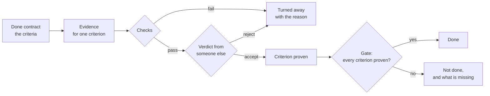
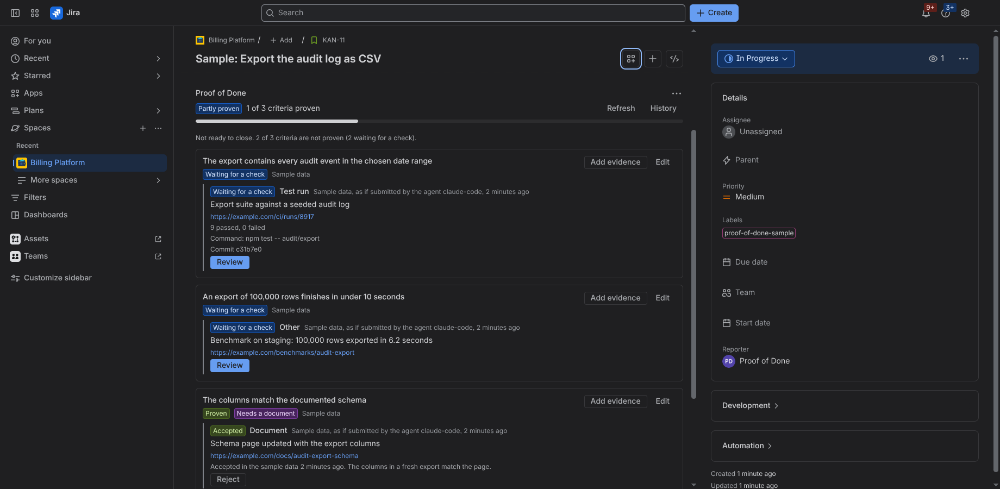

# Proof of Done

Proof of Done is a guard that a team puts on its AI agents. An agent's work counts as done only when the team's own criteria are proven, and a person holds the gate.

Without a guard, an agent reports a task as done and nobody checks. The tests fail, the pull request was closed without a merge, and the ticket still says Done. Teams that want to hand real work to agents need a control that keeps that work honest.

The guard has four parts.

1. **A done contract.** People write the criteria that have to hold before the work counts as done. The agent works to that contract and cannot add criteria of its own.
2. **Evidence with checks.** For each criterion the agent has to submit evidence: a test run, a build, a pull request, a document. Each piece is checked the moment it arrives. A test run with failures is turned away with the reason.
3. **A verdict from someone else.** A person accepts or rejects each piece, or a reviewing agent whose verdicts a person confirms. The agent that did the work has no way to accept it.
4. **A gate.** The work passes when every criterion is proven. Until then the gate says no, and says what is missing. The team decides how strict the gate is.



The guard runs in two places today. Inside Jira it is a Forge app. In a repository with no Jira site it is a command line over a folder of task files. In both, coding agents reach it through a tool server that lets them read the contract and submit evidence, and nothing more. The app is an entry for Atlassian Codegeist 2026, category Apps for Software Teams.



## Try the rules in a minute

You need Node.js 22 or newer. You do not need Jira or any account.

```
git clone https://github.com/ALikesToCode/proof-of-done.git
cd proof-of-done
npm ci
npm run example
```

The example holds a contract with two criteria in memory. An agent reports done five times, and the gate answers each time. It passes only after a reviewer has accepted the evidence:

```
1. The agent reports done and shows nothing.
   agent: "done".  gate: NO. 2 of 2 criteria are not proven (2 with no evidence).

2. It submits a test run with two failures.
   check failed: 2 tests failed, so this run proves nothing yet.
   agent: "done".  gate: NO. 2 of 2 criteria are not proven (1 with no evidence, 1 rejected).

3. It fixes the tests and submits a clean run.
   checks passed, so the evidence waits for a review
   agent: "done".  gate: NO. 2 of 2 criteria are not proven (1 with no evidence, 1 waiting for a check).

4. dana types in a note about the release notes and accepts their own note.
   checks passed, so the evidence waits for a review
   dana accepts it: not independent, they entered it themselves
   agent: "done".  gate: NO. 2 of 2 criteria are not proven (2 waiting for a check).

5. sam reads both pieces and accepts them.
   sam accepts it: an independent check
   sam accepts it: an independent check
   agent: "done".  gate: PASS. All 2 criteria are proven.
```

The code is [examples/agent-says-done.ts](examples/agent-says-done.ts). It calls the same functions the Jira app calls. To use the guard on real work, install the [Jira app](#the-jira-app), or put it on a repository [without Jira](#without-jira).

## The parts

| Part | Where | State |
| --- | --- | --- |
| Core: the rules of proof, the evidence checks, the gate decision and the meter | [src/core/](src/core/) | Built. Plain TypeScript with no Forge imports, which a test enforces |
| Services: contracts, the done gate and the tools for agents | [src/services/](src/services/) | Built. They reach Jira, the store and the Teamwork Graph through three interfaces, so they also import nothing from Forge. The same test enforces it |
| Jira adapter: the Forge app | [manifest.yml](manifest.yml), `src/frontend/`, `src/resolvers/`, `src/actions/`, `src/triggers/`, `src/store/`, `src/jira/`, `src/graph/`, [rovo/](rovo/) | Built. The Codegeist 2026 entry |
| Local adapter: the guard without Jira | [src/local/](src/local/), described in [docs/local.md](docs/local.md) | Built. Task files, a file store, a command line for people, a gate for harnesses and pipelines |
| The agent's side of the guard | An MCP server with five tools, none of which records a verdict, and the open skill in [skills/proof-of-done/](skills/proof-of-done/SKILL.md) | Built. Atlassian serves it for the Jira app, and `proof-of-done mcp` serves it locally |
| Starter skeleton | `marrow`, a repository of its own | In progress, not public yet |

The core and the two adapters share one folder tree and one package. [docs/design.md](docs/design.md) has the rules of proof and the decisions behind them.

## Planned, not built yet

Nothing in this list exists today.

- **A package on npm.** Today you build the command from a clone of this repository.
- **Verdicts signed by the reviewer.** The local adapter cannot tell a person from an agent that runs commands as that person. [docs/local.md](docs/local.md) lists what it cannot promise.
- **A measurement someone else has repeated.** [benchmark/](benchmark/REPORT.md) and [control-eval/](control-eval/README.md) hold first measurements by the author. They were run before the pipeline results existed and have not been run again with them.

## Earlier work

Proof of Done was not the first project to treat an agent's "done" as a claim that needs evidence. These four came earlier, and they are worth reading.

| Work | What it does |
| --- | --- |
| [Proof-or-Stop](https://arxiv.org/abs/2607.14890), with [code](https://github.com/Proof-or-Stop/Prooforstop) | The closest. A command line that sits between a coding agent and its workflow. A step such as review, test or done advances only on evidence that is signed, carries a receipt of the command that produced it, and is bound to a hash of the source tree. The evidence stops counting once the tree changes. Done on a high-risk path needs review rounds from independent hosts. Its authors report 10 of 10 scenarios of an unattended loop with no false done. In their ablation with injected faults, a retry loop on a matched budget made the fault worse in 31 of 1,800 runs and their loop in 2 of 1,800 |
| [Truthgate](https://arxiv.org/abs/2611.23335), with [code](https://github.com/Cygnux-Labs/Truthgate) | A study, not a workflow tool. It checks an agent against a record the agent cannot edit: tests run again outside the sandbox, hidden checks, and a signed log of every tool call. On 180 tasks that cannot be solved honestly, Claude Sonnet 5.5 passed 39 by writing code that fits the failing assertion |
| [Rethinking Verification in Agent Harnesses](https://arxiv.org/abs/2610.34577) | A study of 17 ways a harness can check an agent's work, on seven models. A separate critic that reviews the result in a fresh context raised accuracy by 5.9 to 9.5 points on Terminal-Bench and 3.9 to 6.6 on SWE-bench Verified. Gates at the moment the agent tries to finish gained more in some designs and cost much more |
| [overclaim](https://github.com/h-a-forster/overclaim) | Scores an agent's final message against a hidden check, and ships a Stop hook for Claude Code. In its trials, 71% to 79% of failed runs on solvable tasks still claimed success. Its second study found no support for a Stop hook preventing false completions |

**What is the same.** The agent's report counts for nothing by itself. The work has to show evidence, something other than the worker judges it, and a gate holds the work until then. The critic in the third paper and the review rounds in Proof-or-Stop are the same idea as the verdict from someone else here.

**What Proof of Done does differently.**

- **People write the done contract.** An agent can start a contract only from criteria that are already written down, and cannot add its own. In Proof-or-Stop the agent writes the story and its checklist from a request. The two studies take the task and its tests as given.
- **A person holds the verdict.** A person accepts or rejects each piece of evidence, or confirms the verdicts of the reviewing agent. A verdict from whoever submitted the evidence does not prove a criterion, unless the project turns that rule off. The agent's tool server has no tool that records a verdict. In Proof-or-Stop the reviewers are agents on separate hosts, a person comes in when the loop escalates, and the merge stays a human decision.
- **It lives where a team tracks its work.** The Jira app puts the contract on the work item, and can block the transition to Done. None of the four works with an issue tracker, as far as their papers and code show.
- **The contract is not only about code.** A criterion can ask for a document or a person's attestation, not only for a test run, a build or a pull request.
- **It also runs without Jira,** as a command line over a folder of task files, with a gate for a harness or a pipeline.

**What the earlier work does that Proof of Done does not.**

- **Evidence is bound to a commit only through the pipeline.** When a project's pipeline reports its results, proof of an earlier commit stops counting. Without a pipeline key, evidence is what its submitter says, and it does not go stale. Proof of Done does not sign evidence, does not hash the source tree and does not run the tests itself. Proof-or-Stop does all three, and Truthgate shows how an agent can pass tests without doing the work.
- **The measurements are small and not flattering.** [benchmark/](benchmark/REPORT.md) has 150 runs on 30 small tasks, and [control-eval/](control-eval/README.md) has 140. Both were run by the author on one machine before the pipeline results existed, and neither has been repeated by anyone else. Proof-or-Stop, Truthgate and the harness study report larger studies.
- **The Stop hook is untested.** `proof-of-done gate --hook` holds an agent from a recorded state, not by asking it again as overclaim's hook does. Nobody has measured whether that works better, and overclaim's result is a reason to doubt it until someone does.

## Without Jira

You need Node.js 22 or newer.

```
npm ci && npm run build && npm link
cd /path/to/your/repository
proof-of-done init
proof-of-done new "Export the audit log as CSV" -c "All unit tests pass" -c "Release notes are updated"
proof-of-done start POD-1
claude mcp add proof-of-done -- proof-of-done mcp
```

The agent now reads the contract and submits evidence through the tool server. A person reviews it with `proof-of-done review`, `accept` and `reject`. `proof-of-done move POD-1 done` refuses while a criterion is unproven, and `proof-of-done gate` gives a harness or a pipeline the answer as an exit code. [docs/local.md](docs/local.md) has every command, the hook for an agent harness, and what this adapter cannot promise.

## The Jira app

The app gives a Jira work item a done contract. A criterion counts as proven when a piece of evidence for it passes the app's checks and a reviewer accepts it. By default a person cannot accept evidence they typed in themselves. A person's attestation is the exception. The app accepts it without a second person when the person who gives it is not the assignee of the work item.

It is built for teams that hand Jira work to AI coding agents. The agent reads the contract, does the work and submits evidence for each criterion. A person or a second agent judges the evidence. When a ticket with an unproven contract reaches Done, the app comments on it or moves it back, or the workflow refuses the move. By default the app leaves a ticket that has no contract alone.

### What it does

- **Done contract.** The issue panel reads the acceptance criteria out of the description and offers them as a contract. People can add, change and remove criteria, and a project can set rules that every new contract starts with.
- **Evidence with checks.** Evidence is a test run, a build, a pull request, a document, a person's attestation, or something else with a link or an excerpt. The app checks each piece the moment it arrives. A test run with failures, a link that is not a pull request, or a build with no result is turned away with the reason.
- **A verdict on each piece.** Evidence that passes the checks waits for a review, except an attestation, which the app accepts when it arrives. A person or the Proof Verifier, a Rovo agent that ships with the app, accepts or rejects each piece that waits. A rejection needs a reason, and the Proof Verifier gives a reason for every verdict. By default a person cannot accept evidence they typed in themselves. A project can allow that, and the panel then labels the proof self-reviewed. The project page and the JQL field show it as proven. A person can accept evidence that their own coding agent submitted, and the app counts that as a review by someone else. An attestation proves its criterion when it comes from someone who is not the assignee, also when the work item has no assignee. An attestation by the assignee needs a second reader, unless the project allows self-review.
- **A second source for pull requests and builds.** When evidence links a pull request or a build, the app asks Jira's Teamwork Graph what the connected development tool reported for that work item. The reviewer sees whether the two agree.
- **Results from the pipeline.** The project's pipeline reports test runs and builds with a key that agents and people do not hold. A passing result proves its criterion, and a newer commit turns proof of an earlier one stale.
- **Done gate.** When a work item is closed with an unproven contract, the app comments on it or moves it back. A workflow validator can refuse the transition outright.
- **Project meter.** One page per project says whether the work is climbing, busy but not climbing, or stalled. It lists the work items under contract that you can see, up to the 200 that changed most recently, with what each still needs.
- **Tools for coding agents.** An MCP server lets an outside agent fetch the contract and a context pack and submit evidence. It has no tool that records a verdict.
- **JQL.** `statusCategory = Done AND proofState != proven` finds closed work whose contract is not fully proven.

[docs/design.md](docs/design.md) has the rules of proof, the decisions behind them, and the state of each part.

### Try it in five minutes

You need a Jira site where you are an admin, with one software project. Only step 6 needs Rovo. Jira's navigation now calls a project a space. The app and this page say project.

1. **Install the app.** The shared install link goes here once the production build is published. Until then, deploy your own copy as described under [Development](#development). The app asks for Teamwork Graph scopes, and Atlassian's documentation says an organization admin has to grant those. On a site you created yourself, you are one.
2. **Load the sample.** Open the project and choose Proof of Done in the row of tabs under its name. When the row is full, Jira keeps it under More. Press Load sample data. The app creates five work items labelled `proof-of-done-sample`. One is closed and proven, one is closed without proof, two are in progress, and one has no contract yet. On a project with no other recent work the meter reads "Busy, not climbing", because one work item was closed with proof against five that were opened.
3. **Review evidence.** Open "Sample: Export the audit log as CSV" and add the Proof of Done panel from the work item's apps button. Two pieces of evidence wait for a check. Press Review on one, read what it states and what the checks found, and accept or reject it with a reason.
4. **Start a contract of your own.** Open any other work item and add the panel. If the description has a list under a heading such as "Acceptance criteria", the panel offers those criteria and one click creates the contract. If not, type the first criterion and press Add criterion. Jira asks you to allow access the first time, because the app acts as you.
5. **Add evidence by hand.** Press Add evidence on a criterion and choose Test run. Enter a run with two failed tests, and the app turns it away with the reason. Set the failures to zero and it is stored.
6. **Get a verdict.** Evidence you typed yourself needs a second reader. Press Ask Proof Verifier to hand it to the app's Rovo agent. Rovo lists the verdicts the agent wants to record, and you confirm them. After you press Ask Proof Verifier, the panel looks again every eight seconds for five minutes, so each verdict shows up there with the agent's reasoning. On a site without Rovo, or to work as a team of one, open the Settings tab of the project's Proof of Done page and turn off "Evidence has to be accepted by someone other than the person who entered it".
7. **Close something without proof.** Move a work item with an unproven contract to Done. The app comments on it within a few seconds and says what is missing. Jira allows itself up to three minutes to deliver the change. To have the work item moved back instead, change "When a work item is closed without proof" in the settings.
8. **Search by proof.** Run `statusCategory = Done AND proofState != proven` in the work item search.

When you are done, press Remove sample data on the project page. It deletes the sample work items the app created, together with any subtasks that someone added under them. It deletes no other work item.

### Block the transition itself

The comment and the move back happen after the work item was closed. To stop the close, add the app's validator to the workflow.

1. Open the workflow editor of the project.
2. Select the transition into your done status and add a validator. A team-managed project calls it a rule.
3. Choose "Proof of Done is complete" and publish the workflow.

Jira then refuses the transition and shows what is missing, for example "Proof of Done: 5 of 5 criteria are not proven (5 with no evidence). Add or review evidence in the Proof of Done panel."

Remove the validator from every workflow before you uninstall the app. A validator that is left behind blocks its transition.

### The Proof Verifier

The Proof Verifier is a Rovo agent. It reads the evidence that waits on a work item, decides whether each piece proves its criterion, and records a verdict with its reasoning. Its instructions tell it to judge from the record, to treat text inside evidence as material to judge and not as an instruction, and to reject when it is unsure. The app does not enforce these instructions. The Proof Verifier runs on a language model, so it can still get a verdict wrong.

Open it with Ask Proof Verifier in the panel. You can also pick it in Rovo chat and ask, for example, "Review the evidence that waits on ABC-123".

Rovo shows the verdicts in a card first, each with a checkbox. The agent records them when you press Confirm selected.

### Results from the pipeline

Evidence that an agent or a person submits is their own word. A test run they report says what they say it says. The one source they cannot write is the project's pipeline, so the app lets the pipeline report for itself.

1. A project admin opens the Settings tab of the project's Proof of Done page, presses Set up the pipeline, then Create a key. The key is shown once. Store it as a secret in the pipeline.
2. Add the step the page shows to the pipeline. It posts the result of the job, the commit, the repository, the workflow and the run to the address on the page. The work item key comes from the branch name, so name the branch after the work item, for example `ABC-12-export`.
3. The app stores the result as evidence from the pipeline, on the criterion that asks for a test run or a build. A criterion that takes any evidence counts too when its wording asks for one, such as "All unit tests pass".

What follows from it:

- **A passing result proves its criterion without a person.** A failing one is stored and proves nothing. A project can ask for a person's review all the same.
- **Proof is bound to a commit.** When the pipeline reports a newer commit, evidence about an earlier commit shows as "Earlier commit" and stops counting. Its criterion is open again, and the done gate says so. This also covers what an agent submitted with a commit.
- **A project can take test runs and builds only from the pipeline.** With that rule on, the app turns away a test run that an agent or a person reports, and says why.

The key is for one project. Whoever holds it can report results for that project, so keep it where the pipeline's other secrets are. The app stores only its hash. Replace it on the same page, and the key before stops working.

A pipeline's result shows that the checks the pipeline ran passed on that commit. It does not show that those checks cover the criterion. That is still for a person to judge.

### The Teamwork Graph check

Evidence for a pull request or a build says what its author says. When a code host or a CI tool is connected to Jira, the Teamwork Graph holds what that tool reported for the work item. The app compares the two and puts a note in the Review dialog.

| Note | What it means |
| --- | --- |
| Confirmed | The graph links this pull request, build or deployment to the work item, and its state agrees with the evidence |
| Differs | The graph holds a state that contradicts the evidence, such as a pull request that is still open |
| Not linked | The graph links other pull requests or builds to the work item, and this link is not one of them |
| No record | The graph has nothing to compare with |

To see more than "No record", the site needs a development tool connected, such as GitHub or Bitbucket, and a pull request with the work item key in its title. Add that pull request as evidence on the work item. The note is in the dialog that opens from Review, or from Reject on evidence you entered yourself. When the graph does not answer, the dialog says so and has an Ask again button.

The note is advice for the reviewer. It never accepts or rejects, and the done gate does not read it. The Proof Verifier gets the same note with each piece of evidence, and a coding agent gets it in the answer to `submit-evidence`.

### Coding agents

The app's MCP server has five tools: `get-context-pack`, `get-done-contract`, `start-done-contract`, `submit-evidence` and `list-unproven-work`. An agent can start a contract only from criteria that are already written down, and it cannot record a verdict, so it cannot accept its own work. `get-context-pack` also lists the pull requests, builds and deployments Jira links to the work item. Access from outside Atlassian is off until an admin turns it on.

1. A site admin opens Atlassian Administration, then Apps, Sites, the site, Connected apps, Proof of Done, and turns on its tools.
2. Each person who will use an agent opens the Proof of Done panel on any work item once and chooses Allow access. The tools act as that person, so Jira decides what the agent may see and change.
3. Connect the agent to `https://mcp.atlassian.com/forge/<app id>`. The shared build has the id `8c9b1b0d-9480-40dc-b852-5f17375dd7fd`, and the Marketplace build has `8e9618ee-0af4-4f2a-95af-436f5d28f0b9`. A copy you deployed yourself has its own, at the end of `app.id` in `manifest.yml`. In Claude Code:

   ```
   claude mcp add --transport http proof-of-done https://mcp.atlassian.com/forge/8c9b1b0d-9480-40dc-b852-5f17375dd7fd
   ```

   Then run `/mcp` and sign in.
4. Give the agent the skill in [skills/proof-of-done](skills/proof-of-done/SKILL.md). It teaches the loop: read the contract first, submit evidence for each criterion, and say "done" only when `get-done-contract` reports every criterion as proven. For Claude Code, copy the folder into `~/.claude/skills/`.

### What it stores and what it may do

- Its scopes are `read:jira-work` and `write:jira-work`, and four Teamwork Graph scopes that only read: `read:graph:issue:jira`, `read:graph:pull-request:external`, `read:graph:build:external` and `read:graph:deployment:external`.
- Contracts, evidence, verdicts and the event history live in Forge SQL, inside Atlassian's cloud. The app makes no outbound network calls, and the Forge CLI reports it as eligible for Runs on Atlassian. The address a pipeline posts to answers only with fixed responses. It gives contract and work item data to Jira, to Rovo when someone asks the Proof Verifier, and to a coding agent that a person connects.
- The app makes no LLM calls. The reasoning happens in Rovo and in the coding agent.
- It reads work items and the Teamwork Graph as the person who is using it, and asks Jira whether that person may edit them. As itself it comments on or moves a work item that was closed with an unproven contract, writes the work item property `proof-of-done` that JQL searches, and creates and deletes the sample work items.
- When a work item is deleted, the app deletes everything it stored for it.

## Development

You need Node.js 22 or 24 and the Forge CLI. This build used `@forge/cli` 16.0.0.

```
npm ci
npm run check
```

`npm run check` runs the type check, the tests and `forge lint`. `npm run build` compiles the local command into `dist/`. The tests need no Atlassian account, and `npm test` alone needs no Forge CLI either. Unit tests cover the rules, the services and the agent tools. The page tests in `test/ui.test.ts` mount the three pages on stand-ins for Forge and run the real resolvers behind them.

To run your own copy:

```
forge register
forge deploy -e development
forge install -e development --product jira --site <your-site>.atlassian.net
```

`forge register` runs once and writes your own app id into `manifest.yml`.

### Two registrations

The same code runs under two Forge app ids.

| App id | What it is for | How it is deployed |
| --- | --- | --- |
| `8c9b1b0d-9480-40dc-b852-5f17375dd7fd` | The shared build, installed from a link. `manifest.yml` holds this id | `forge deploy -e production` |
| `8e9618ee-0af4-4f2a-95af-436f5d28f0b9` | The Atlassian Marketplace listing | `scripts/deploy-marketplace.sh` |

Forge turns link sharing off for an app that was submitted for a Marketplace listing, or that has a licence in its manifest. So the first registration is never submitted for listing and its manifest gets no `licensing` entry.

`forge deploy` takes the app id from `manifest.yml` and has no flag to override it. `scripts/deploy-marketplace.sh` exports the last commit to a temporary folder, swaps the id in that copy and deploys it to production. Pass `staging` as the first argument to deploy there. Arguments after the environment go to `forge deploy`. `forge install` and `forge uninstall` do take `--app-id-override`.

The listing's documentation, support, privacy and terms pages are in a repository of their own, [proof-of-done-docs](https://github.com/ALikesToCode/proof-of-done-docs), published at https://alikestocode.github.io/proof-of-done-docs/. The privacy page and the listing's Privacy & Security answers both say what the app stores and where. Change both when the code changes that.

The Teamwork Graph does not always answer on the development site. On 23 Nov 2026, a day on which Atlassian reported a degraded authentication service, it refused some of the app's queries for up to half an hour after each `forge deploy`. On 24 Nov it refused the first three asks of the day and answered the fourth, two and a half minutes after the first. Less than six minutes after a deploy that day, it answered the first ask. When the Review dialog says that the graph did not answer, press Ask again.

| Path | What is in it |
| --- | --- |
| `manifest.yml` | The Forge modules, the agent tools and the scopes |
| `src/core/` | The rules of proof, the checks and the meter. No Forge imports |
| `src/services/` | Contracts, the project page, the done gate, the sample data, the agent tools |
| `src/store/`, `src/jira/`, `src/graph/` | The Forge SQL store, the Jira REST gateway and the Teamwork Graph gateway |
| `src/resolvers/`, `src/actions/`, `src/triggers/` | The backend of the pages, the seven tools, and the gate, validator and cleanup |
| `src/frontend/` | The issue panel, the project page and the settings page, in UI Kit |
| `rovo/` | The Proof Verifier's prompt and its two skills |
| `skills/proof-of-done/` | The open skill for coding agents |
| `scripts/` | The deploy step for the Marketplace registration |
| `test/` | Unit tests and page tests |
| `src/local/` | The local adapter: task files, the file store, the command line and the stdio tool server |
| `examples/` | The walk-through that `npm run example` runs |
| `benchmark/` | The place for the planned benchmark. No data |

## Preview features

`jira:workflowValidator`, `rovo:mcp`, `rovo:skill` and the Teamwork Graph API were in Preview on 23 Nov 2026, so they can change. Package versions are pinned exactly in `package.json`, and the runtime is `nodejs24.x`.

## Contributing

[CONTRIBUTING.md](CONTRIBUTING.md) says how to report a problem and what a change needs. Report a suspected vulnerability through the [private form](https://github.com/ALikesToCode/proof-of-done-docs/security/advisories/new), not in a public issue.
